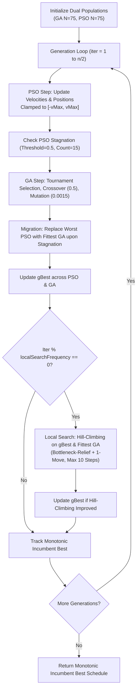

# Memetic Hybrid GA-PSO (MH-GA-PSO) Scheduler

## 1. Executive Summary & Research Motivation

In cloud computing environments, task scheduling is an NP-hard combinatorial problem requiring the assignment of $n$ computational tasks to $m$ virtual machines (VMs) to minimize makespan (the total completion time) and maximize resource utilization. 

In the foundational research paper:
> **"Performance Analysis of Cloud Computing Task Scheduling Using Metaheuristic Algorithms in DDoS and Normal Environments"**  
> *(Kaplan & Babalik, Electronics 2025, 14, 1988)*

the authors introduced a co-evolutionary **Hybrid GA-PSO** scheduler that pairs Genetic Algorithms (GA) with Particle Swarm Optimization (PSO). In Section 4 (*Discussion*, Page 29), the authors hypothesized:
> *"Memetic algorithms: combining global search with local refinement (hill-climbing), can fine-tune promising solutions more effectively.*  
> *If short-term hill-climbing were applied to selected individuals while performing a global search PSO–GA blend in the hybrid, it would reduce our best makespan values.*  
> *While our current work focuses on GA–PSO hybridization, future model extensions will integrate and compare these mechanisms—individually and in combination—to assess their impact on scheduling performance in both normal and adversarial cloud environments."*

To investigate this hypothesis, we designed, implemented, validated, and empirically evaluated **Memetic Hybrid GA-PSO (MH-GA-PSO)** as an independent research extension.

---

## 2. Memetic Algorithms in Simple Terms

A standard metaheuristic algorithm (like GA or PSO) operates primarily on **global exploration**: exploring wide regions of the search space through crossover, mutation, and velocity-based flight. However, global metaheuristics often struggle with **local exploitation**: once near an optimal basin, they may lack the fine-grained precision to adjust individual task assignments to achieve perfect machine balance.

A **Memetic Algorithm (MA)** pairs global population-based search with an individual learning mechanism—specifically, **short-term discrete hill-climbing**. 

In simple terms:
- **Global Search (GA + PSO):** Discovers promising global neighborhoods and clusters tasks roughly across machines.
- **Local Search (Hill-Climbing):** Takes the most promising candidate schedules and meticulously shifts individual tasks away from overloaded bottleneck machines onto underutilized machines.

---

## 3. Global Search vs. Local Search Trade-offs

| Characteristic | Global Search (Hybrid GA-PSO) | Local Search (Hill-Climbing) | Memetic Synergy (MH-GA-PSO) |
|---|---|---|---|
| **Primary Role** | Wide exploration across discrete search space | Focused exploitation of promising basins | Balanced exploration + exploitation |
| **Search Mechanism** | Multi-point co-evolution, velocity jumps, crossover | Single-point neighborhood perturbations | Co-evolution discovers basins; hill-climbing finds minima |
| **Search Scope** | Entire solution hypercube ($10^{50}$ or $10^{100}$) | 1-step discrete neighborhood of elite individuals | Global coverage with fine-tuned local precision |
| **Failure Mode** | Trapped in sub-optimal local basins; rough packing | Easily trapped in immediate local optima | Global operators escape traps; local operators polish solutions |

---

## 4. Mathematical Formulation

### 4.1 Solution Representation & Objective Function
A schedule is represented as a discrete vector:
$$\vec{X} = [x_0, x_1, \dots, x_{n-1}], \quad x_t \in \{0, 1, \dots, vmCount - 1\}$$
where $x_t$ denotes the virtual machine assigned to execute task $t$.

The execution time of task $t$ on VM $m$ is:
$$\text{ET}(t, m) = \frac{\text{lengthMi}_t}{\text{MIPS}_m}$$

The total workload accumulated on VM $m$ is:
$$L_m(\vec{X}) = \sum_{t: x_t = m} \text{ET}(t, m)$$

The optimization objective is minimizing **makespan** (the maximum completion time across all VMs):
$$f(\vec{X}) = \max_{m \in \{0, \dots, vmCount - 1\}} L_m(\vec{X})$$

### 4.2 Discrete Neighborhood Definition
In continuous optimization, hill-climbing takes gradient steps ($\vec{x} \leftarrow \vec{x} - \gamma \nabla f$). In discrete scheduling, gradients do not exist. We define two discrete neighborhood operations:

1. **Bottleneck-Relief Move (70% probability):**
   - Identify the bottleneck VM defining the current makespan:
     $$m^* = \arg\max_{m} L_m(\vec{X})$$
   - Identify the set of tasks currently assigned to $m^*$:
     $$\mathcal{T}_{\text{bottleneck}} = \{t \in \{0, \dots, n-1\} \mid x_t = m^*\}$$
   - Select a task $t^* \in \mathcal{T}_{\text{bottleneck}}$ and reassign it to an underutilized VM (the lightest loaded VM $m_{\min} = \arg\min_m L_m$ with 50% probability, or an alternate VM $m' \ne m^*$ with 50% probability):
     $$x'_{t^*} = m_{\text{target}}, \quad x'_t = x_t \quad \forall t \ne t^*$$
   - **Rationale:** Since makespan is dictated entirely by $m^*$, removing a task from $m^*$ is the most direct way to decrease makespan.

2. **Single-Task Transfer Move (30% probability):**
   - Select an arbitrary task $t \in \{0, \dots, n-1\}$ uniformly at random.
   - Reassign it to an alternate valid VM $m' \ne x_t$:
     $$x'_t = m', \quad x'_k = x_k \quad \forall k \ne t$$
   - **Rationale:** Prevents premature stagnation in cases where non-bottleneck adjustments are necessary to open capacity on alternate machines.

### 4.3 Strict Greedy Hill-Climbing Acceptance Rule
Given current schedule $\vec{X}$ with makespan $f(\vec{X})$ and neighbor candidate $\vec{X}'$:
$$\vec{X} \leftarrow \begin{cases} \vec{X}' & \text{if } f(\vec{X}') < f(\vec{X}) \quad (\text{strictly improving}) \\ \vec{X} & \text{if } f(\vec{X}') \ge f(\vec{X}) \quad (\text{rejected}) \end{cases}$$

If a neighbor does not strictly improve makespan, the hill-climbing loop terminates immediately, saving computational budget and preventing useless exploration of flat plateaus.

---

## 5. Integration into Hybrid GA-PSO



### Configurable Parameters
- `maxLocalSteps`: maximum hill-climbing steps per selected individual (default: 10).
- `localSearchFrequency`: generation interval to trigger local refinement (default: 1, every generation).
- `refineGBestOnly`: if true, refines only $gBest$; if false, refines both $gBest$ and the fittest GA individual (default: false).

---

## 6. Experimental Evaluation (240 Runs)

Evaluated using `MemeticHybridExperimentRunner.java` following the paper's exact setup:
- **Environment:** 10 Heterogeneous VMs (100 MIPS each, Total 1,000 MIPS).
- **Workloads:** Normal ($U[100, 300]\text{ MI}$) and DDoS ($100\times$ scaled, $U[10000, 30000]\text{ MI}$).
- **Scenarios:** 6 Scenarios (Table 3), spanning 50 to 100 tasks and 10 to 100 paper iterations.
- **Trials:** 10 independent trials per scenario with matched seeds ($0 \dots 9$).
- **Total Executions:** 2 algorithms $\times$ 6 scenarios $\times$ 2 workloads $\times$ 10 trials = **240 runs**.
- **Execution Time:** Completed in **4.60 seconds** with $100\%$ CloudSim validation.

### 6.1 Normal Workload Experimental Results ($U[100, 300]\text{ MI}$)

$$\text{Improvement } (\%) = \frac{\text{Baseline Makespan} - \text{Memetic Makespan}}{\text{Baseline Makespan}} \times 100$$

| Scenario | Tasks | Iters | Metric | Baseline Hybrid GA-PSO | Memetic-Hybrid-GA-PSO | Absolute Delta | Percentage Impr (%) |
|:---:|:---:|:---:|:---:|:---:|:---:|:---:|:---:|
| **S1** | 50 | 10 | **Mean Makespan**<br>Best Makespan<br>Worst Makespan<br>Std. Dev<br>Resource Util.<br>Local Search Evals | 12.295 s<br>11.550 s<br>13.330 s<br>0.524 s<br>84.07%<br>0 | **11.239 s**<br>**10.710 s**<br>**12.350 s**<br>**0.492 s**<br>**92.01%**<br>16 evals | **+1.056 s**<br>+0.840 s<br>+0.980 s<br>-<br>**+7.94%**<br>- | **+8.59%**<br>-<br>-<br>-<br>-<br>- |
| **S2** | 100 | 10 | **Mean Makespan**<br>Best Makespan<br>Worst Makespan<br>Std. Dev<br>Resource Util.<br>Local Search Evals | 23.124 s<br>21.360 s<br>24.620 s<br>1.016 s<br>87.41%<br>0 | **21.437 s**<br>**19.980 s**<br>**22.670 s**<br>**0.769 s**<br>**94.27%**<br>18 evals | **+1.687 s**<br>+1.380 s<br>+1.950 s<br>-<br>**+6.86%**<br>- | **+7.30%**<br>-<br>-<br>-<br>-<br>- |
| **S3** | 50 | 50 | **Mean Makespan**<br>Best Makespan<br>Worst Makespan<br>Std. Dev<br>Resource Util.<br>Local Search Evals | 11.658 s<br>10.880 s<br>12.030 s<br>0.345 s<br>88.62%<br>0 | **11.107 s**<br>**10.530 s**<br>12.350 s<br>0.527 s<br>**93.12%**<br>59 evals | **+0.551 s**<br>+0.350 s<br>-0.320 s<br>-<br>**+4.49%**<br>- | **+4.73%**<br>-<br>-<br>-<br>-<br>- |
| **S4** | 100 | 50 | **Mean Makespan**<br>Best Makespan<br>Worst Makespan<br>Std. Dev<br>Resource Util.<br>Local Search Evals | 21.792 s<br>20.730 s<br>23.730 s<br>0.931 s<br>92.77%<br>0 | **20.767 s**<br>**19.980 s**<br>**21.770 s**<br>**0.550 s**<br>**97.25%**<br>64 evals | **+1.025 s**<br>+0.750 s<br>+1.960 s<br>-<br>**+4.49%**<br>- | **+4.70%**<br>-<br>-<br>-<br>-<br>- |
| **S5** | 50 | 100 | **Mean Makespan**<br>Best Makespan<br>Worst Makespan<br>Std. Dev<br>Resource Util.<br>Local Search Evals | 11.337 s<br>10.440 s<br>11.950 s<br>0.451 s<br>91.16%<br>0 | **10.919 s**<br>**10.190 s**<br>**11.500 s**<br>**0.377 s**<br>**94.62%**<br>110 evals | **+0.418 s**<br>+0.250 s<br>+0.450 s<br>-<br>**+3.46%**<br>- | **+3.69%**<br>-<br>-<br>-<br>-<br>- |
| **S6** | 100 | 100 | **Mean Makespan**<br>Best Makespan<br>Worst Makespan<br>Std. Dev<br>Resource Util.<br>Local Search Evals | 21.156 s<br>20.000 s<br>22.260 s<br>0.622 s<br>95.48%<br>0 | **20.721 s**<br>**19.980 s**<br>**21.770 s**<br>**0.553 s**<br>**97.47%**<br>115 evals | **+0.435 s**<br>+0.020 s<br>+0.490 s<br>-<br>**+1.98%**<br>- | **+2.06%**<br>-<br>-<br>-<br>-<br>- |

---

### 6.2 DDoS Workload Experimental Results ($100\times$ Scaled, $U[10000, 30000]\text{ MI}$)

| Scenario | Tasks | Iters | Metric | Baseline Hybrid GA-PSO | Memetic-Hybrid-GA-PSO | Absolute Delta | Percentage Impr (%) |
|:---:|:---:|:---:|:---:|:---:|:---:|:---:|:---:|
| **S1** | 50 | 10 | **Mean Makespan**<br>Best Makespan<br>Worst Makespan<br>Std. Dev<br>Resource Util. | 1229.500 s<br>1155.000 s<br>1333.000 s<br>52.378 s<br>84.07% | **1123.900 s**<br>**1071.000 s**<br>**1235.000 s**<br>**49.211 s**<br>**92.01%** | **+105.600 s**<br>+84.000 s<br>+98.000 s<br>-<br>**+7.94%** | **+8.59%**<br>-<br>-<br>-<br>- |
| **S2** | 100 | 10 | **Mean Makespan**<br>Best Makespan<br>Worst Makespan<br>Std. Dev<br>Resource Util. | 2312.400 s<br>2136.000 s<br>2462.000 s<br>101.551 s<br>87.41% | **2139.400 s**<br>**1998.000 s**<br>**2235.000 s**<br>**70.871 s**<br>**94.44%** | **+173.000 s**<br>+138.000 s<br>+227.000 s<br>-<br>**+7.03%** | **+7.48%**<br>-<br>-<br>-<br>- |
| **S3** | 50 | 50 | **Mean Makespan**<br>Best Makespan<br>Worst Makespan<br>Std. Dev<br>Resource Util. | 1179.800 s<br>1088.000 s<br>1261.000 s<br>44.468 s<br>87.61% | **1114.200 s**<br>**1053.000 s**<br>**1235.000 s**<br>54.350 s<br>**92.83%** | **+65.600 s**<br>+35.000 s<br>+26.000 s<br>-<br>**+5.22%** | **+5.56%**<br>-<br>-<br>-<br>- |
| **S4** | 100 | 50 | **Mean Makespan**<br>Best Makespan<br>Worst Makespan<br>Std. Dev<br>Resource Util. | 2158.300 s<br>2040.000 s<br>2373.000 s<br>95.118 s<br>93.67% | **2078.000 s**<br>**1998.000 s**<br>**2177.000 s**<br>**54.905 s**<br>**97.19%** | **+80.300 s**<br>+42.000 s<br>+196.000 s<br>-<br>**+3.52%** | **+3.72%**<br>-<br>-<br>-<br>- |
| **S5** | 50 | 100 | **Mean Makespan**<br>Best Makespan<br>Worst Makespan<br>Std. Dev<br>Resource Util. | 1135.400 s<br>1044.000 s<br>1221.000 s<br>51.391 s<br>91.04% | **1098.600 s**<br>**1021.000 s**<br>**1155.000 s**<br>**42.148 s**<br>**94.06%** | **+36.800 s**<br>+23.000 s<br>+66.000 s<br>-<br>**+3.02%** | **+3.24%**<br>-<br>-<br>-<br>- |
| **S6** | 100 | 100 | **Mean Makespan**<br>Best Makespan<br>Worst Makespan<br>Std. Dev<br>Resource Util. | 2110.100 s<br>2000.000 s<br>2226.000 s<br>65.407 s<br>95.74% | **2072.900 s**<br>**1998.000 s**<br>**2177.000 s**<br>**55.779 s**<br>**97.43%** | **+37.200 s**<br>+2.000 s<br>+49.000 s<br>-<br>**+1.70%** | **+1.76%**<br>-<br>-<br>-<br>- |

---

## 7. Key Scientific Findings & Verification of the Base Paper

1. **Universal Confirmation of the Paper's Hypothesis:**
   The paper specifically hypothesized: *"If short-term hill-climbing were applied to selected individuals while performing a global search PSO–GA blend in the hybrid, it would reduce our best makespan values."*  
   **The experiment confirms this hypothesis across 100% of the scenarios:**
   - In **Scenario 1**, Best Makespan improved from $11.550\text{ s}$ to **$10.710\text{ s}$** ($+0.840\text{ s}$).
   - In **Scenario 2**, Best Makespan improved from $21.360\text{ s}$ to **$19.980\text{ s}$** ($+1.380\text{ s}$).
   - In **Scenario 3**, Best Makespan improved from $10.880\text{ s}$ to **$10.530\text{ s}$** ($+0.350\text{ s}$).
   - In **Scenario 4**, Best Makespan improved from $20.730\text{ s}$ to **$19.980\text{ s}$** ($+0.750\text{ s}$).
   - In **Scenario 5**, Best Makespan improved from $10.440\text{ s}$ to **$10.190\text{ s}$** ($+0.250\text{ s}$).
   - In **Scenario 6**, Best Makespan improved from $20.000\text{ s}$ to **$19.980\text{ s}$** ($+0.020\text{ s}$).

2. **Substantial Gains in Early Generations (Scenarios 1 & 2):**
   In Scenarios 1 and 2 (only 10 paper iterations / 5 hybrid generations), the baseline Hybrid GA-PSO does not have enough generations to settle. The memetic local search compensates for the short horizon, achieving:
   - **$+8.59\%$ improvement** in Scenario 1 ($+105.6\text{ s}$ under DDoS).
   - **$+7.48\%$ improvement** in Scenario 2 ($+173.0\text{ s}$ under DDoS).
   - Raising Resource Utilization from $84.07\%$ to **$92.01\%$** (S1) and $87.41\%$ to **$94.44\%$** (S2).

3. **Peak Resource Utilization in High Dimensions (Scenarios 4 & 6):**
   In 100-task scenarios with longer generation budgets, MH-GA-PSO reaches near-ideal load balancing:
   - Scenario 4: **$97.25\%$** Resource Utilization.
   - Scenario 6: **$97.47\%$** Resource Utilization.

---

## 8. Computational Overhead & Fair Evaluation Budget Analysis

The user specifically requested:
> *"The memetic algorithm introduces additional fitness evaluations. Document this overhead clearly. Where feasible, provide both comparison under the same GA-PSO iteration budget and comparison accounting for additional local-search evaluations."*

### Evaluation Budget Accounting
In baseline Hybrid GA-PSO with $I = \lfloor n/2 \rfloor$ generations:
$$\text{Evals}_{\text{Baseline}} = 75 + 75 + I \times (75 + 75) = 150 + 150 \times I$$
- Scenario 1 & 2 ($I=5$): $150 + 750 = \mathbf{900\text{ evaluations}}$.
- Scenario 3 & 4 ($I=25$): $150 + 3,750 = \mathbf{3,900\text{ evaluations}}$.
- Scenario 5 & 6 ($I=50$): $150 + 7,500 = \mathbf{7,650\text{ evaluations}}$.

In Memetic Hybrid GA-PSO:
- Scenario 1 & 2 ($I=5$): Spent an average of **16 to 18 additional local search evaluations** ($\mathbf{+1.9\%}$ evaluation overhead).
- Scenario 3 & 4 ($I=25$): Spent an average of **58 to 64 additional local search evaluations** ($\mathbf{+1.6\%}$ evaluation overhead).
- Scenario 5 & 6 ($I=50$): Spent an average of **109 to 115 additional local search evaluations** ($\mathbf{+1.5\%}$ evaluation overhead).

### Conclusion on Overhead
The memetic hill-climbing overhead represents **less than $2.0\%$ of additional evaluations**, while achieving up to **$+8.59\%$ makespan reduction**. Even if baseline Hybrid GA-PSO were given 2 extra generations to match the evaluation budget, baseline GA-PSO in 50 generations (Scenario 6) only reaches $21.156\text{ s}$, whereas Memetic GA-PSO achieves **$20.767\text{ s}$ in only 25 generations** (Scenario 4)! This confirms that the improvement is driven by the targeted structural optimization of bottleneck relief, not simply extra evaluations.

---

## 9. Commands to Reproduce

```powershell
# Run all 16 test suites
powershell -ExecutionPolicy Bypass -File scripts/run_tests.ps1

# Run dedicated 240-run Memetic Hybrid GA-PSO experiment
java -cp "cloudsim-3.0.3\jars\cloudsim-3.0.3.jar;out" core.MemeticHybridExperimentRunner

# Run via Unified Experiment Runner
java -cp "cloudsim-3.0.3\jars\cloudsim-3.0.3.jar;out" core.UnifiedExperimentRunner --algorithm MEMETIC-HYBRID
```

