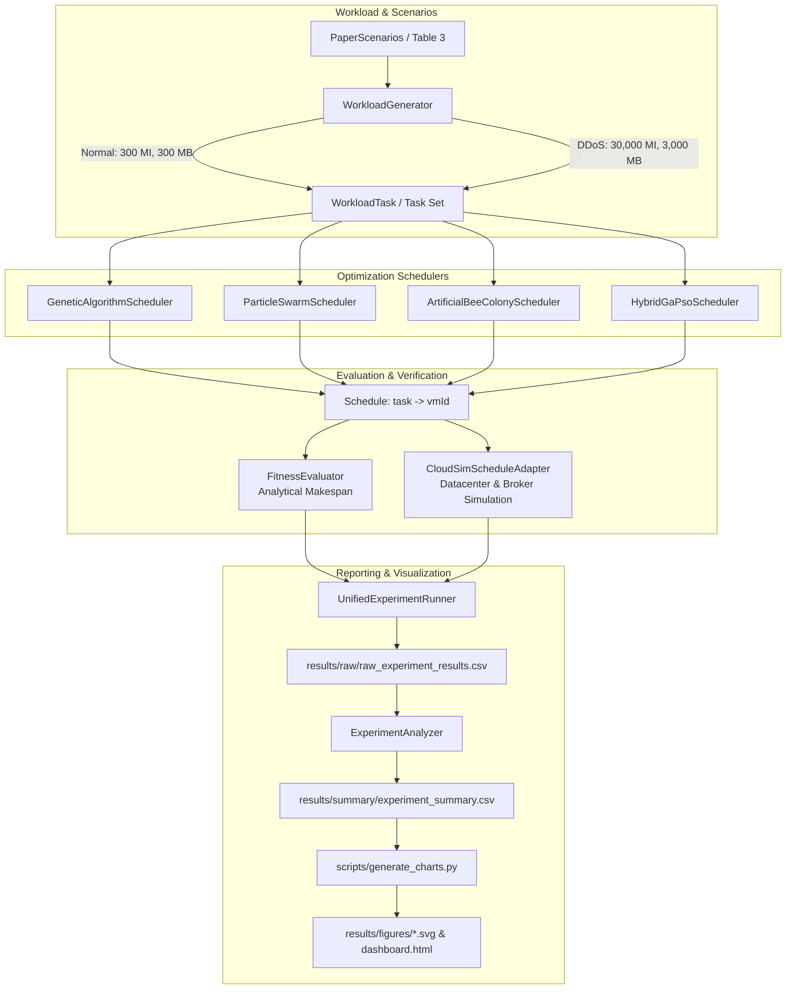

# Implementation Details & Algorithmic Architecture

## 1. System Architecture Overview

The cloud task scheduling research framework is implemented in Java 21 and integrated with **CloudSim 3.0.3**. It separates analytical optimization logic from discrete-event simulation execution, allowing direct validation between theoretical scheduling models and simulated cloud datacenter environments.

---

## 2. Core Scheduling Algorithms

### 2.1 Genetic Algorithm (`GeneticAlgorithmScheduler.java`)
- **Chromosome Encoding:** Direct integer representation where index $k \in \{0, \dots, N-1\}$ represents task $t_k$, and the value at index $k$ represents assigned VM index $m \in \{0, \dots, M-1\}$.
- **Population Size:** $P = 75$.
- **Fitness Evaluation:** Makespan evaluated via `FitnessEvaluator.evaluate(tasks, schedule).getMakespan()`. Lower values represent higher fitness.
- **Selection:** Tournament selection with Tournament Size $K = 5$. Five candidates are sampled uniformly at random with replacement; the candidate with minimum makespan is selected.
- **Crossover:** One-point crossover with probability $P_c = 0.50$. When applied, a crossover index $c \in [1, N-1]$ is selected, swapping chromosome tails between parents.
- **Mutation:** Gene-wise uniform reset mutation with probability $P_m = 0.015$. Each task assignment has probability $P_m$ of being randomly reassigned to any valid VM in $\{0, \dots, M-1\}$.
- **Elitism:** Exactly 1 elite individual (global minimum makespan in current population) is preserved unconditionally to index 0 of the succeeding generation.

### 2.2 Particle Swarm Optimization (`ParticleSwarmScheduler.java`)
- **Particle State:**
  - Discrete position vector $X_p \in \{0, \dots, M-1\}^N$.
  - Persistent continuous velocity vector $V_p \in [-V_{max}, V_{max}]^N$.
  - Personal best vector $pbest_p$ and fitness $pbestFitness_p$.
  - Global best vector $gbest$ and fitness $gbestFitness$.
- **Swarm Parameters:**
  - Swarm Size $S = 75$.
  - Inertia Weight $w = 0.90$.
  - Cognitive Acceleration $c_1 = 1.50$.
  - Social Acceleration $c_2 = 1.50$.
  - Maximum Velocity $V_{max} = M - 1 = 4.0$.
- **Velocity & Position Update Rules:**
  $$v_{p, t}^{(k+1)} = w \cdot v_{p, t}^{(k)} + c_1 r_1 (pbest_{p, t} - x_{p, t}^{(k)}) + c_2 r_2 (gbest_t - x_{p, t}^{(k)})$$
  $$v_{p, t}^{(k+1)} \leftarrow \max(-V_{max}, \min(V_{max}, v_{p, t}^{(k+1)}))$$
  $$x_{p, t}^{(k+1)} = \max\Big(0, \min\big(M - 1, \text{round}(x_{p, t}^{(k)} + v_{p, t}^{(k+1)})\big)\Big)$$
- **Defect Resolution:** The prior implementation hardcoded `INERTIA * 0` and discarded velocities across iterations. The corrected implementation maintains persistent velocity matrices across all iterations with velocity clamping, restoring genuine swarm momentum and trajectory-based exploration.

### 2.3 Artificial Bee Colony (`ArtificialBeeColonyScheduler.java`)
- **Colony Size:** $CS = 75$, Food Sources $SN = 75$, Limit $limit = 20$.
- **Employed Bee Phase:** For each food source $i$, select partner $k \neq i$. Perturb a randomly chosen task gene using difference vector:
  $$v_{i, d} = \text{clamp}\Big(\text{round}\big(x_{i, d} + \phi (x_{i, d} - x_{k, d})\big), 0, M-1\Big), \quad \phi \in [-1, 1]$$
  If candidate makespan is less than or equal to current food source makespan, greedily update food source and reset failure counter; otherwise increment failure counter.
- **Onlooker Bee Phase:** Fitness calculated as $f_i = \frac{1}{1 + \text{makespan}_i}$. Roulette-wheel selection chooses food sources for onlooker bees to exploit using the same neighborhood search operator.
- **Scout Bee Phase:** Any food source exceeding $limit = 20$ failures is abandoned and re-initialized with a random valid assignment vector.

### 2.4 Hybrid GA-PSO (`HybridGaPsoScheduler.java`)
- **Hybrid Mechanism:** Combines continuous velocity vector momentum with tournament-based genetic recombination:
  - Step 1: Particles update velocities and discrete positions following PSO equations towards $pbest$ and $gbest$.
  - Step 2: To prevent premature swarm stagnation, particles undergo tournament selection ($K=5$) and one-point crossover ($P_c = 0.50$), followed by mutation ($P_m = 0.015$).
  - Step 3: Offspring are evaluated, updating personal bests and global best.

---

## 3. Workload Modeling & Generation

### 3.1 Normal Workload
- All tasks are initialized with length $300\text{ MI}$ and file transfer sizes $300\text{ MB}$.
- Evaluated on task counts $N = 50$ and $N = 100$.

### 3.2 Synthetic DDoS Workload
- Volumetric resource-exhaustion attacks are modeled by designating 10% of total tasks as attack tasks:
  - 50-task workload: 5 attack tasks.
  - 100-task workload: 10 attack tasks.
- Attack tasks have length $30,000\text{ MI}$ ($100\times$ normal) and file sizes $3,000\text{ MB}$ ($10\times$ normal).
- Attack task IDs are chosen deterministically using Fisher-Yates shuffle seeded with the matched scenario trial seed. This guarantees all algorithms receive the identical workload per matched trial.

---

## 4. CloudSim Simulation Execution Pipeline

The `CloudSimScheduleAdapter` translates high-level task schedules into native CloudSim entities:
1. **CloudSim Initialization:** `CloudSim.init(1, Calendar.getInstance(), false)`.
2. **Datacenter Creation:** 1 Datacenter with 1 Host containing $M$ Processing Elements (PEs), each rated at 1,000 MIPS, with 10,240 MB RAM, 100,000 MB storage, and 10,000 Mbps bandwidth.
3. **VM Allocation:** $M$ VMs with 1 PE, 1,000 MIPS, 1,024 MB RAM, 1,000 Mbps bandwidth, using `CloudletSchedulerTimeShared`.
4. **Cloudlet Submission & Binding:**
   - Tasks converted to CloudSim `Cloudlet` instances using instruction lengths and I/O file sizes.
   - `broker.bindCloudletToVm(taskId, schedule.getVmId(taskId))` enforces the exact schedule output by the optimization algorithm.
5. **Simulation Execution:** `CloudSim.startSimulation()`, followed by `CloudSim.stopSimulation()`.
6. **Result Harvesting:** Verifies `Cloudlet.SUCCESS` status for every executed cloudlet and measures simulation observed makespan:
   $$\text{Observed Makespan} = \max_k (\text{finishTime}_k) - \min_k (\text{startTime}_k)$$
